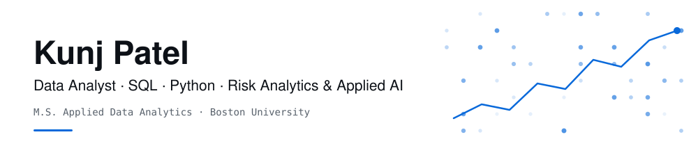

<picture>
  <source media="(prefers-color-scheme: dark)" srcset="assets/header-dark.svg">
  
</picture>

I turn raw data into decisions someone can act on, from regulators' Call Report filings to a credit or referral cut-off. Before grad school I spent a year shipping production software: a hospital information system used by 1,000+ healthcare workers, and a sales-analytics platform where I went from intern to leading a team of five.

What I care about: **checking the number before I trust it.** That habit runs through my work. Auditing my own trading backtest, I found look-ahead leakage that had made three strategies look profitable; after the fix, none beat buy-and-hold. In a medical-referral model, the "winning" classifier only won because of where its threshold sat.

- 🎓 &nbsp;M.S. Applied Data Analytics, **Boston University** (GPA 3.8)
- 🔭 &nbsp;Looking for **Data Analyst and Risk Analytics** roles, especially in **banking and financial services**
- 📫 &nbsp;[LinkedIn](https://linkedin.com/in/kunj2710) · [kunjpatel271002@gmail.com](mailto:kunjpatel271002@gmail.com) · Boston, MA

 

## Selected work

**[U.S. Bank Health Monitor](https://github.com/Kunj2710/bank-health-sql)**: SQL and dbt over every U.S. bank's Call Report
 Models the FFIEC filings for 4,168 banks ($26.6T in assets) into peer benchmarks and an SVB-style stress screen: 25 banks pair majority-uninsured deposits with securities losses above 25% of Tier 1 capital. 19 data tests, including a balance-sheet identity check on every bank. &nbsp;`SQL` `DuckDB` `dbt` `Python`

**[Beyond Accuracy](https://github.com/Kunj2710/cvd-referral-cost-classifier)**: Choosing a referral model under a fixed budget
 Six classifiers on 70K patients. At a 500:1 cost ratio the cost-optimal rule refers almost everyone, so the useful question is a capacity limit, the same problem as lending under a budget. At a 40% referral budget Random Forest catches the most cases. Includes a fairness audit (equal opportunity, four-fifths rule). &nbsp;`scikit-learn` `pandas`

**[SEC Filings Q&A (RAG)](https://github.com/Kunj2710/rag-document-qa)**: Retrieval-augmented Q&A with a labelled evaluation set
 LangChain pipeline with pluggable vector stores and LLMs, evaluated on 30 hand-labelled questions over 1,880 passages from JPMorgan, Apple, Chevron, Pfizer and Walmart 10-Ks: hit rate, MRR and p50/p95 latency (FAISS about 10× faster than Chroma). &nbsp;`LangChain` `FAISS` `FastAPI`

**[Football Market Value](https://github.com/Kunj2710/football-market-value-analysis)**: What drives a player's transfer price?
 Regression, ANOVA, χ² and logistic models on 900 top-5-league players, framed as six questions a club would ask. With controls for league, position and output, players over 30 are valued about 81% below under-23s. &nbsp;`R`

**[Disability Prediction, AHS 2023](https://github.com/Kunj2710/ahs-disability-prediction)**: Imbalanced classification on Census survey data *(team project)*
 Found that 72% of "numeric" columns were category codes by reading the 313-page codebook. 93 model runs, plus a check showing that "undersampling beat SMOTE" was mostly a threshold effect (AUC 0.84). &nbsp;`scikit-learn` `imbalanced-learn` `XGBoost`

**[WikiFlow](https://github.com/Kunj2710/wikiflow)**: Predicting Wikipedia editor dropout from 60M revision events
 Logistic regression and K-Means written from scratch on Spark RDDs, a distributed Keras DNN, and live scoring of the edit stream through Kafka on GCP Dataproc and BigQuery. &nbsp;`PySpark` `Kafka` `GCP`

 

<!-- more-projects:start -->
## More projects

| | Project | Result |
|:--|:--|:--|
| 📈 | [**Can ML beat buy-and-hold?**](https://github.com/Kunj2710/stock-trading-ml-backtest) | Audited my own backtest: after removing look-ahead leakage and adding costs and walk-forward retraining, no model beats buy-and-hold, and the best sits within luck against random strategies |
| 🗄️ | [**Cassandra vs MongoDB**](https://github.com/Kunj2710/cassandra-vs-mongodb-benchmark) | Four workloads on 1M NYC taxi trips: Cassandra writes 2.2× faster, MongoDB aggregates 5× faster, with the caveats stated |
| 🫀 | [**Fetal health from CTG**](https://github.com/Kunj2710/fetal-health-ctg-classifier) | 88.8% accuracy, but only 63% of abnormal cases caught: why imbalance hides failure |
| 🏢 | [**BU building energy benchmarks**](https://github.com/Kunj2710/boston-building-energy-benchmarks) | 82 BU buildings run about 40% above Boston's average energy intensity (city BERDO data) |
| 🔗 | [**Clustering Dow Jones stocks**](https://github.com/Kunj2710/dow-jones-stock-clustering) | Residual-return k-means over 60 months; sector peers don't reliably move together |
| 💵 | [**Banknote forgery detection**](https://github.com/Kunj2710/banknote-forgery-detection) | From a 71% hand-written rule to 100% with kNN on the UCI dataset, plus a feature-ablation study |
<!-- more-projects:end -->

 

## Experience

**Software Developer** · Artem HealthTech &nbsp;2024
 Cut page-load time 35% on a hospital information system used by 1,000+ healthcare workers. A Redis caching layer reduced database load 40% and saved $3K/month.

**Project Leader** · Wellnest Tech &nbsp;2024 · promoted from intern in 3 months
 Led 5 developers on an Angular/.NET sales-analytics platform for 200+ daily users. Built CI/CD that cut deploys from 3 days to 4 hours.

**Software Developer Intern** · Telnet &nbsp;2023
 Built an Angular recipe platform for 500+ beta users. Its one-click cart reached 70% adoption in two weeks.

 

## Toolbox

**Daily** &nbsp;SQL · Python · pandas · scikit-learn · Git · Jupyter
 **Analytics engineering** &nbsp;dbt · DuckDB · PostgreSQL · MySQL · BigQuery · PySpark
 **BI** &nbsp;Tableau · Power BI · Excel
 **Also shipped with** &nbsp;R · Kafka · LangChain · FastAPI · Streamlit · TensorFlow/Keras · XGBoost · FAISS · MongoDB · Cassandra · GCP · AWS · Docker
